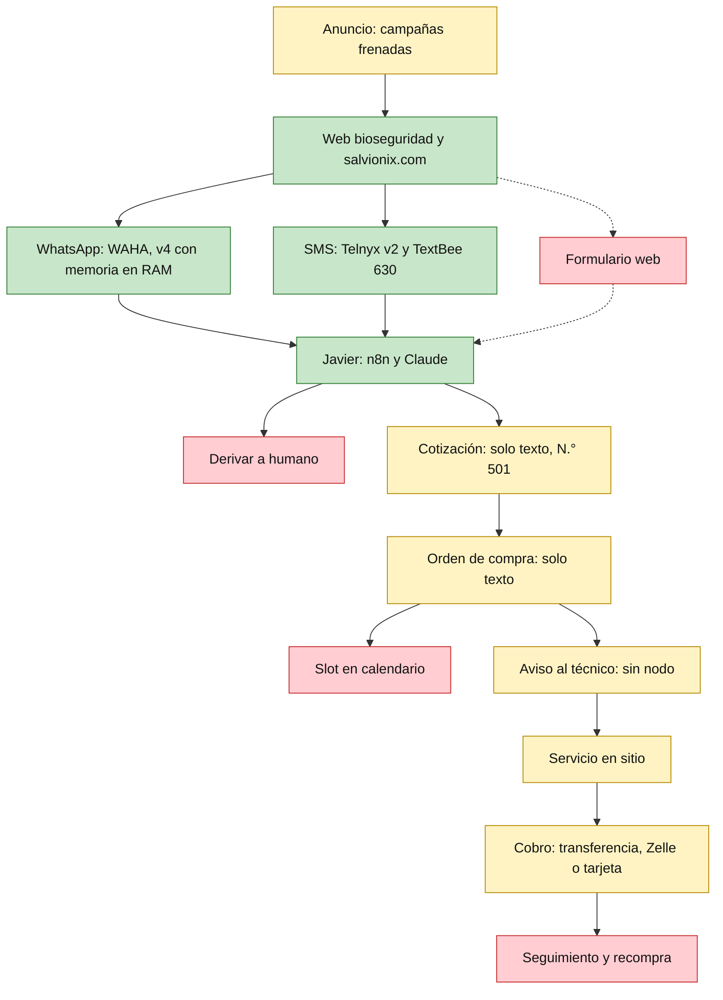
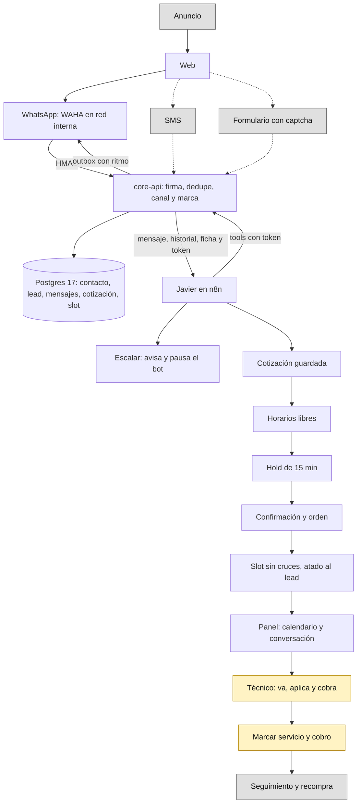

# Auditoría Salvionix antes del CRM

- **Fecha:** lunes 02/11/2026 (hora de Guayaquil, UTC-5)
- **Preparada para:** Sebastián (BYTOGAM)
- **Tipo:** solo lectura. No se modificó código, no se instaló nada, no se hicieron commits y no se tocó ningún servidor.

**Claves de citas**

| Clave | Archivo |
|---|---|
| `[BIT]` | `Downloads\bitacora_salvionix_20261101.md` |
| `[JSON]` | `Downloads\TEST - Javier WhatsApp - PostgreSQL Memory (1).json` (la exportación más reciente, 01/11 08:40) |
| `[SM]` | System message dentro de `[JSON]`, nodo AI Agent. La línea es la de ese texto (378 líneas, las mismas que indica `[BIT]`:72) |
| `[ROUTER]` | Código del nodo Router. Todo está en `[JSON]`:84, por eso se cita por nombre de constante |
| `[ARQ]` | `C:\Trabajo\Conversaciones\JM\<chat de JM>\Arquitectura y orquestación maestra — Salvionix Bytogam (Fase 1).md` |
| `[BASE]` | `Arquitectura base y seguridad — CRM Salvionix (pre-producción).md`, dentro de `C:\Trabajo\Conversaciones\JT\Chat de WhatsApp con ..zip` |
| `[PLAN]` | `C:\Trabajo\Conversaciones\JM\<chat de JM>\Plan_de_trabajo_Fase_1_CRM_Salvionix.pdf` |
| `[EST]` | `respuesta_de_estimado_fase_1-1.md`, dentro del mismo zip de `[BASE]` |
| `[GRAB]` | `C:\Trabajo\Conversaciones\Reunion Personal\Grabacion1.txt` |
| `[CHAT-JM]` | `C:\Trabajo\Conversaciones\JM\<chat de JM>\<chat de JM>.txt` |
| `[AUD-JM]` | `C:\Trabajo\Conversaciones\JM\01_Conversacion_WhatsApp_JM_con_audios_2026-10-27_al_30.docx` (párrafo) |
| `[REU-JM]` | `C:\Trabajo\Conversaciones\JM\transcripci_n_de_la_reuni_n.txt` |
| `[R27]` | `C:\Trabajo\Conversaciones\Reuniones\BYTOGAM_Reunion_27-10-2026_Contexto_Tareas_y_Transcripcion.docx` (párrafo) |
| `[GRUPO]` | `C:\Trabajo\Conversaciones\Grupo Bytogam\...\Chat de WhatsApp con BYTOGAM (Desarrollo general).txt` |
| `[FTP]` | `Downloads\sebas-salvionix-vscode-ftp.md` |
| `[WEB-ES]` / `[WEB-EN]` | `C:\Projects Trabajo\BIOSEGURIDAD_FUENTE_VPS\bioseguridad\es\index.html` / `...\bioseguridad\index.html` |
| `[SALV]` | `C:\Projects Trabajo\SALVIONIX_LOCAL\` |
| `[LOCAL]` | `C:\CRM` (checkout principal, con cambios sin commit) |

Las rutas sin clave (`src/...`, `supabase/...`) son de este worktree, en el commit `e54f7a15`, igual a `origin/main`.

> **Correcciones de Sebastián tras la revisión (02/11/2026)**, que prevalecen sobre el texto de abajo:
> 1. **No hay precios fijos.** Los valores del prompt de Javier ($0,12 y $0,06 por pie², 7%, mínimo $150) son **ejemplos**. La cotización debe leer una tabla configurable y versionada; los valores se cargan como datos de ejemplo "por confirmar". Igual la disponibilidad del técnico y el margen entre servicios.
> 2. **El desarrollo es para el dominio de bioseguridad** (`bioseguridad.bytogam.com`, servido por Caddy en el VPS), no para salvionix.com en Hostinger. El formulario de salvionix.com queda fuera. Dónde viven `crm` y `api` (y si se usa Cloudflare) es **POR DECIDIR con Joel**.
> 3. **El compromiso con JM es en dos partes:** Entrega 1 en ≈10 días (bot con memoria en el CRM y calendario de slots, funcionando) y CRM completo en 3–4 semanas desde el 29/10 (Entregas 2 y 3, ≈24/11). Ver la sección 8.3.
> 4. Los IDs de tarea pasan a `CRM-T0` … `CRM-T13` (los T0–T13 de la sección 8.2).

---

## 1. Resumen ejecutivo

1. **El compromiso y el plan no hablan de lo mismo.** A JM se le prometió CRM + bot + calendario en ≈10 días (`[CHAT-JM]`:145-147). El plan de 45–48 h deja fuera el panel y las tools de agenda (`[PLAN]` p. 1-2).
2. **Los ≈10 días no alcanzan para el MVP completo.** Estimo 75,5 h base y ≈91 h con margen: listo para producción hacia el **24/11**. Lo único que cabe hasta el 08/11 es una demo en el número de pruebas, casi sin margen (28,5 h de ≈29,6 h disponibles).
3. **El trabajo del CRM corre riesgo.** Son 57 archivos sin commit en `C:\CRM`, y el único remoto configurado es `marmelab/atomic-crm`. Este worktree no los contiene. Es lo primero que hay que resolver.
4. **Javier hoy no puede leer ni escribir en un CRM.** El workflow TEST no tiene ninguna tool (`[JSON]`, conexiones del AI Agent). Cotización y orden existen solo como texto en el chat, siempre con el N.° 501 (`[SM]`:268).
5. **El bot promete una agenda que no existe.** Acepta cualquier fecha y dice "ya quedó agendado" (`[SM]`:322, 366, 368). Eso choca de frente con la prioridad de JM de slots sin cruces.
6. **La derivación a Esteban no existe en TEST.** "Le consulto a mi supervisor" no dispara ningún nodo, y "Esteban" aparece 0 veces en el JSON.
7. **Supabase: no lo recomiendo en producción.** Propongo un dataProvider propio y delgado contra `core-api`, apoyado en PostgREST interno (≈14–18 h, sujeto a un spike de 2 h y al OK de Joel).
8. **Licencias:** Atomic CRM y sus dependencias de producción permiten venderlo. **El punto delicado es n8n**: su licencia limita el uso a fines internos, así que no puede ir dentro del producto que se venda.

---

## 2. Inventario

**Aviso sobre cómo se obtuvo.** La sesión arrancó sin las carpetas de `/add-dir` ni la carpeta `contexto\`. Para no detenerme busqué por nombre en el disco y encontré casi todo. Solo leí los tipos de documento de tu lista.

| Pedido en el prompt | Estado | Dónde está |
|---|---|---|
| Repo del CRM | ✅ Dos copias que **no son iguales** | Worktree `e54f7a15` (upstream limpio) y `[LOCAL]` en `489537c3`, con cambios sin commit |
| `BIOSEGURIDAD_FUENTE_VPS\bioseguridad` | ✅ | `C:\Projects Trabajo\BIOSEGURIDAD_FUENTE_VPS\` |
| `bitacora_salvionix_20261101.md` | ✅ | `Downloads\` |
| `system_message_javier_telefono_20261101.txt` | 🟡 Archivo no encontrado; usé el texto dentro del JSON, que tiene las 378 líneas esperadas | `[SM]` |
| JSON workflow TEST | ✅ Dos exportaciones; solo difiere el nodo AI Agent | `Downloads\` |
| JSON workflow v4 (producción) | ❌ No está. `backups\n8n\wf-GiVZR3YGbEDcm6k5-antes-idioma.json` pesa 0 bytes | — |
| Flujos SMS (Telnyx v2, TextBee 630) | ❌ No están | Solo lo que dice `[BIT]` |
| `Arquitectura base y seguridad...md` | ✅ Leído dentro del zip, sin extraer | `[BASE]` |
| `Arquitectura y orquestación maestra...md` | ✅ | `[ARQ]` |
| `Plan_de_trabajo_Fase_1_CRM_Salvionix.pdf` | ✅ | `[PLAN]` |
| `respuesta_de_estimado_fase_1.md` | ✅ Leído dentro del zip, sin extraer | `[EST]` |
| `Grabacion1.txt` | ✅ | `[GRAB]` |
| Respaldo de salvionix.com | 🟡 **SUPUESTO:** `[SALV]` es esa copia, porque es la carpeta de trabajo FTP y sus fechas (27/10) coinciden con `backups\publicados\salvionix-20261027-030245.tgz` | `[SALV]` |
| `docker-compose.yml` y `Caddyfile` del VPS | ❌ Las copias locales en `BYTOGAM_BOTS_LOCAL` pesan 0 bytes. No se pudo auditar el despliegue real | — |

**Revisión limitada.** La llamada con Joel y los documentos `[R27]` y Relevo se revisaron solo por palabras clave. `C:\Projects Trabajo\BYTOGAM_BOTS_LOCAL\` no estaba en tu lista: solo miré nombres de archivo y no abrí `propuestas\salvionix-v2\` más allá de su README.

### Hallazgos de seguridad (para que los cambies)

Solo se indica dónde están. Los valores no se copian aquí.

| Archivo y línea | Qué hay |
|---|---|
| `Downloads\zip.zip` → `chat.md`:811 | **Contraseña en texto plano.** Conviene rotarla |
| `Downloads\zip.zip` → `chat.md`:444 | Servidor y usuario FTP |
| `[FTP]`:4, 5, 19, 21 | IP y usuario FTP (sin contraseña) |
| `[JSON]`:84 | Teléfonos de probadores y de aviso; **códigos de acceso por marca**; todo en texto plano |
| `[JSON]`:7 | Ruta del webhook de WAHA |
| `[JSON]`:583, 602 | Datos fijados con teléfono de prueba |
| `Downloads\github-recovery-codes.txt` | Por su nombre, códigos de recuperación de GitHub. No lo abrí. Debería estar en Bitwarden |
| `C:\Projects Trabajo\BYTOGAM_BOTS_LOCAL\.env`, `.env.bak-evolution`, `.hostinger-ftp`, `.vscode\sftp.json` | No abiertos |
| `[SALV]\.vscode\sftp.json` | No abierto |
| `[LOCAL]\.env.development.local` | No abierto |
| `[LOCAL]\supabase\functions\.env` | No abierto. Está versionado y tiene 1 línea modificada: revisa que no lleve un secreto antes del primer commit |

`[ROUTER]` tiene `puertaTrasera: true`, y su comentario pide apagarla antes de abrir el bot a clientes reales. Hay que confirmar cómo está en la v4.

**Desvíos que debo reportarte:**
- Abrí `.env.development` del worktree (plantilla versionada del upstream) con los valores enmascarados. Solo vi nombres de variables. Tu regla decía no abrir `.env`.
- Al filtrar `chat.md`, la línea 811 salió con su valor en la salida de esta sesión. No está en ningún entregable, pero pasó por el registro de la sesión: es otra razón para rotarla.
- Lo mismo con teléfonos y códigos de `[JSON]`:84, y con las primeras líneas de `chat.md`, un chat privado que no estaba en tu lista.

---

## 3. Negocio

### 3.1 Según la web

`[WEB-ES]` y `[WEB-EN]` tienen la misma estructura línea por línea. `[SALV]` es el mismo sitio en una versión anterior: difiere en el footer y en los botones de contacto (`diff`: 40 líneas en `es/index.html`).

| Tema | Lo que dice | Cita |
|---|---|---|
| **Qué vende** | Aplicación de Vital Oxide®, "desinfección de grado hospitalario" | `[WEB-ES]`:11, 317, 319 |
| **7 soluciones** | Virus y bacterias, superficies con alimentos, moho y hongos, alérgenos, olores, aire acondicionado, telas | `[WEB-ES]`:351-369 |
| **A quién** | Hogares, oficinas y bodegas, restaurantes, clínicas, veterinarias, gimnasios, escuelas, hoteles | `[WEB-ES]`:442-449 |
| **Zonas** | No nombra ciudades. Solo "en Estados Unidos" | `[WEB-ES]`:548 |
| **Cómo se cotiza** | **No hay precios.** 3 pasos: contacto por WhatsApp, evaluación del espacio con plan, aplicación | `[WEB-ES]`:477-479 |
| **Datos que pide** | Ninguno. **No hay formulario** en ninguna versión (`<form>`: 0 resultados) | `[WEB-ES]`, `[SALV]` |
| **Promesa** | "Nuestro asistente responde tus dudas y agenda la visita en minutos" | `[WEB-ES]`:506 |
| **Frecuencia** | Única, mensual o trimestral | `[WEB-ES]`:495 |
| **Idiomas** | Inglés en `/`, español en `/es/`, con selector | `[WEB-ES]`:21-22, 290 |
| **Legal** | Solo un párrafo sobre la marca y el registro EPA (Reg. N.° 82972-1) de Vital Solutions. **Sin política de privacidad ni términos** | `[WEB-ES]`:548-549 |

**Llamadas a la acción**

| Botón | Canal | Cita |
|---|---|---|
| "Reserva tu servicio" (cabecera, portada, soluciones, cierre) | WhatsApp `wa.me/1630…1555`, con texto prellenado | `[WEB-ES]`:291, 321, 372, 507 |
| Botón flotante | WhatsApp, mismo enlace | `[WEB-ES]`:524 |
| "Escríbenos por WhatsApp" (footer) | WhatsApp, mismo enlace | `[WEB-ES]`:536 |
| SMS flotante | `sms:+1312…3878`, activado por JS | `[WEB-ES]`:523; `assets\contact-actions.js`:2 |

La versión en inglés repite las mismas líneas con "Book your service" (`[WEB-EN]`:291, 321, 372, 507, 524, 536).

**Cambió desde la bitácora.** `[BIT]`:157 dice que `SMS_PHONE_E164` está vacío, pero la copia local ya tiene el número. No verifiqué si está subida al servidor (regla de esta sesión). El 630 sigue siendo la línea personal de un familiar de JM (`[GRUPO]`:59, 63; `[GRAB]`:73, 77).

### 3.2 El modelo según JM

- "Uber de tareas": publicidad, bot, orden, y un técnico capacitado que "va, pone, cobra y se va" (`[GRAB]`:5).
- Escala futura a varias ciudades y estados (`[GRAB]`:5, 9). Hoy: persona en Orlando "con ya la agenda dispuesta" (`[GRAB]`:53). `[ARQ]`:351 agrega Chicago.
- **Las campañas están frenadas** hasta que el canal responda bien (`[R27]` párr. 13, 20, 68).
- JM se va el 20/12 y quiere "todo funcionando" (`[GRAB]`:161).

### 3.3 Contradicciones entre la web y el bot

| Tema | Web | Bot | Riesgo |
|---|---|---|---|
| **Afirmaciones del producto** | Grado hospitalario, virus concretos, parvovirus, toxicidad categoría IV, niños y mascotas (`[WEB-ES]`:407-427, 446-448, 494) | Lo tiene prohibido por ser un pesticida registrado, y lo deriva al supervisor (`[SM]`:44-46, 62) | **Legal.** Lo que el bot no puede decir, la web lo publica |
| **Evaluación previa** | Primero se evalúa y se propone un plan (`[WEB-ES]`:478) | Cotiza a distancia y emite orden sin "revisión en la visita" (`[SM]`:297, 352) | Precio firme sin haber visto el lugar |
| **Frecuencia** | Única, mensual o trimestral (`[WEB-ES]`:495) | Una vez por mes, sujeta a la primera visita (`[SM]`:69-70) | Mensaje inconsistente |
| **Método** | Nebulización (`[WEB-ES]`:392, 479) | Equipo electrostático (`[SM]`:51) | Confirmar cuál es |
| **Agenda** | "Agenda la visita en minutos" (`[WEB-ES]`:506) | Texto sin agenda real (`[SM]`:322) | Promesa sin respaldo |

JM ya pidió "cambios de la web... imágenes y legales" como parte de la prioridad total (`[AUD-JM]` párr. 267). No está en la estimación de este documento.

### 3.4 El flujo comercial real del bot

**Preguntas, en orden**

| Paso | Qué hace | Cita |
|---|---|---|
| 1. Bienvenida | Saludo fijo: nombre y si es hogar o empresa | `[SM]`:101; `[ROUTER]` `saludo` |
| 2. Sondeo | Dudas o problemas (olores, moho, alérgenos) | `[SM]`:110-111 |
| 3a. Hogar | Casa o departamento, dormitorios, garage o parking techado | `[SM]`:145 |
| 3b. Empresa | Pies cuadrados cubiertos y altura de techos | `[SM]`:170 |
| 4. Comodín | Áreas adicionales con 50% de descuento en lo descubierto | `[SM]`:191, 194 |
| 5. Datos de cierre | Hogar: a nombre de quién, celular, correo, zip. Empresa: además nombre de empresa y persona de contacto | `[SM]`:239, 242 |
| 6. Cotización | Documento por chat, N.° 501 | `[SM]`:268, 273-307 |
| 7. Cierre presuntivo | Rango de fechas, mañana o tarde, dirección, validación de zip | `[SM]`:314-329 |
| 8. Orden de compra | Mismo documento, con dirección, fecha y sin "estimado" | `[SM]`:348-355 |
| 9. Despedida | "Tu servicio ya quedó agendado" | `[SM]`:366 |

**Cómo arma la cotización**

- $0,12 por pie² cubierto y $0,06 por pie² descubierto, igual para hogar y empresa (`[SM]`:136-139).
- Hogar: base de 1.000 pie², 140 por dormitorio, 240 el primer auto, 440 para dos, +200 por auto adicional (`[SM]`:159-163).
- Descuento especial del 7%, redondeo al dólar y **piso mínimo de $150** con impuestos (`[SM]`:216-218).
- Si necesita pensarlo: vigencia de 7, 10 o 14 días (`[SM]`:334-336).
- Pago posterior al servicio: transferencia, Zelle o tarjeta (`[SM]`:302-305).
- **La cuenta la hace el modelo**, no un sistema ("revisa la suma dos veces", `[SM]`:221). Los dos ejemplos del prompt sí cuadran al recalcularlos.

**Datos mínimos:** nombre, metraje, celular, correo, zip, día con franja (`[SM]`:78-84). No valida nada de lo que escribe el cliente (`[SM]`:252).

**Cuándo pasa a un humano.** El prompt lo pide en: salud, seguridad, mascotas, niños, descuentos adicionales (`[SM]`:62-64), plagas (`[SM]`:66), zip distinto (`[SM]`:327) y todo lo no previsto (`[SM]`:376). **No hay mecanismo.** Ningún nodo avisa a nadie. El único aviso del workflow es "Enviar notas a Joel", y es para el modo enseñanza de los probadores (`[JSON]`, conexiones; `[ROUTER]` `avisarA`). JM espera que "si se atora, le manda a Esteban" (`[GRAB]`:57). Puede que la v4 lo haga distinto: no pude verla.

**Teléfono.** `telReal` sale de `SenderAlt`, `Sender`, `participant` o `from`, descartando los `@lid` y exigiendo al menos 8 dígitos (`[ROUTER]`). Se usa para el idioma del saludo por prefijo de país y para `memKey`. Javier no lo pide si lo tiene, pero lo confirma antes de cotizar (`[SM]`:13-15, 245, 253).

**Marca y sesión**

- `sesionesDirectas: { salvionix: 'vital', biosafety: 'vital' }` lleva esas sesiones de WAHA directo a Javier, sin menú ni código (`[ROUTER]`).
- Otras sesiones ven el menú de 7 marcas con código de acceso (`[ROUTER]` `marcas`).
- `memKey` = `<sesión>|<teléfono>:<marca>:<generación>` (`[ROUTER]` `salida`).
- La generación vive en `$getWorkflowStaticData`, igual que el estado y los "vistos". `[BIT]`:113 aclara que eso aún no se probó con mensajes reales.
- **Hueco:** el switch "¿Qué hacer?" solo tiene salidas para `responder` y para `bot` con marca `vital`. "Origin Men Center" figura como `activa: true`, y al entrar con su código no saldría a ningún nodo: silencio.
- Cualquiera que escriba `reset` empieza de cero (`[ROUTER]` `palabraReset`).

---

## 4. Flujo actual y flujo objetivo

### 4.1 Hoy

Verde: existe. Amarillo: a mano o sin verificar. Rojo: no existe.

| Paso | Estado | Respaldo |
|---|---|---|
| Anuncio | 🟡 Frenado a propósito | `[R27]` párr. 13, 68 |
| Web | ✅ Publicada; los cambios del footer y SMS aún sin confirmar | `[BIT]`:42-46 |
| WhatsApp producción | ✅ Con memoria en RAM | `[BIT]`:121 |
| SMS | ✅ Telnyx con Postgres; TextBee sin revisar | `[BIT]`:123-124 |
| Formulario | ❌ | `[WEB-ES]`; `[SALV]` |
| Cotización y orden | 🟡 No se guardan | `[SM]`:268; sin nodos de escritura |
| Slot | ❌ | `[SM]`:322 |
| Técnico, servicio, cobro | 🟡 **SUPUESTO:** a mano; no hay ningún nodo ni documento que lo describa | `[GRAB]`:57 |
| Seguimiento | ❌ en operación. En `[LOCAL]` hay un trigger que crea una tarea al ganar, sin conexión con el bot | `[LOCAL]\FLUJO-SALVIONIX.md`:20-23 |

### 4.2 Objetivo del MVP

Gris: después del MVP. Amarillo: sigue a mano en el MVP.

---

## 5. Estado del repo

### 5.1 Hay dos realidades

| | Este worktree | `[LOCAL]` `C:\CRM` |
|---|---|---|
| Commit | `e54f7a15`, igual a `origin/main` del 02/11 | `489537c3` del 30/10, 16 commits detrás |
| Cambios propios | **Ninguno** | **57 sin commit:** 43 modificados y 14 nuevos (+831/−304, sin contar `.env`) |
| Autores en el historial | Solo upstream (`git log`) | Igual |
| Remotos | `origin` = `marmelab/atomic-crm` | Igual: **no hay remoto propio** |

Los chats dicen que se invitó a JM y Joel a un repo (`[CHAT-JM]`:158-160). Este checkout no apunta a ninguno, y `gh` no está instalado, así que no pude ver si existe ni qué contiene.

**Solo un archivo se cruza con los 16 commits nuevos del upstream:** `providers/fakerest/dataProvider.ts` (`git diff --name-only`). Ponerse al día es barato si se hace ya.

### 5.2 Qué cambió `[LOCAL]` respecto al original

- **Idioma español:** `spanishBaseMessages.ts` (263 líneas), `spanishCrmMessages.ts` (567) y `localizeConfiguration.ts`.
- **Marca:** título "Salvionix CRM", logo y tema (`defaultConfiguration.ts`, `index.css`).
- **Etapas:** Nueva consulta, Contactado, Evaluación del espacio, Propuesta enviada, Seguimiento, Servicio contratado, No concretado, Aplazado.
- **Categorías de oportunidad:** las 7 soluciones de la web más "Otro".
- **Oportunidad:** tipo de espacio, dirección, tamaño, `service_visit_date` y `service_visit_time`; empresa opcional (`20261031190000_deal_service_details.sql`).
- **Automatismo:** al pasar a ganada crea una sola tarea de seguimiento (`20261031210000_deal_followup_on_win.sql`).
- **Entorno:** puertos 553xx (`supabase/config.toml`), `INICIAR-CRM.cmd`, `GUIA-CRM.txt`, `FLUJO-SALVIONIX.md`.

**Vale conservarlo casi todo.** Lo único a reemplazar es la visita: una fecha y hora dentro de la oportunidad, de tipo `time without time zone`, no sirve para slots sin cruces ni para varias zonas horarias.

`FLUJO-SALVIONIX.md`:3-4 dice que "el CRM no envía mensajes ni crea citas". Es correcto hoy, y es justo lo que el MVP debe cambiar.

### 5.3 Stack real

Versiones instaladas en `[LOCAL]\node_modules` y rangos de `package.json`:

| Pieza | Versión |
|---|---|
| React / React DOM | 19.3.1 |
| ra-core | 5.15.5 |
| ra-supabase-core | 3.5.2 |
| @supabase/supabase-js | 2.118.0 |
| React Router | 7.18.4 |
| TanStack Query | 5.104.5 |
| React Hook Form | 7.90.0 |
| Tailwind | 4.3.3 |
| Vite / Vitest / TypeScript | ^8.3.5 / ^5.0.5 / ~5.8.3 |
| Node | `.nvmrc` v24.21.0; `.tools` 24.22.2; Node del sistema 22.17.0 |
| Última etiqueta | v1.6.0 |

### 5.4 Cómo obtiene los datos

**Confirmado: Supabase por defecto.**

- `CRM.tsx`:128-129 usa por defecto los proveedores de `providers/supabase`.
- `providers/supabase/dataProvider.ts`:27 usa `supabaseDataProvider`, y `authProvider.ts`:8 usa `supabaseAuthProvider`.
- Además del CRUD usa `auth.signUp` (:94), Edge Functions (:120, 159, 196, 255), RPC `global_search` (:243) y Storage (:457, 491, 500).
- Métodos propios a mantener en cualquier proveedor: `signUp`, `salesCreate`, `salesUpdate`, `updatePassword`, `unarchiveDeal`, `isInitialized`, `globalSearch`, `mergeContacts`, `getConfiguration`, `updateConfiguration` (:93-276).
- Diez archivos importan algo de Supabase (`grep`), entre ellos `LoginPage.tsx`, `CRM.tsx` y las 3 páginas de `components/supabase/`.
- El esquema depende de Supabase: `auth.users` (`01_tables.sql`:171; `04_triggers.sql`:78-84), `auth.uid()` (`02_functions.sql`:290, 470) y `storage.objects` (`07_storage.sql`:6-8).
- La propia documentación avisa que sus variables de entorno se siguen exigiendo con FakeRest (`doc/src/content/docs/developers/data-providers.mdx`:56).

### 5.5 Qué existe y qué no

| Pieza | Estado | Respaldo |
|---|---|---|
| `core-api` | ❌ | `grep` sin resultados en worktree |
| Esquema propio multimarca | ❌ | `supabase/schemas/01_tables.sql` no tiene `tenant_id` |
| Calendario | ❌ Solo inputs de fecha | `grep` de `calendar`, `tstzrange`, `btree_gist` |
| Docker de producción | ❌ Solo `.devcontainer/Dockerfile` | `find` |
| Tests | ✅ 46 unitarios y 7 e2e | `find` |
| Multiusuario con permisos | ❌ 33 políticas, casi todas `using (true)` | `05_policies.sql`:20-62 |

### 5.6 ¿Compila?

| Comprobación | Resultado | Comando |
|---|---|---|
| Typecheck de `[LOCAL]` | ✅ Sin errores (20 s) | `tsc --noEmit --project tsconfig.app.json` |
| Tests `functions` | ✅ 7 archivos, 192 tests | `CI=true vitest run --project functions --cache=false` |
| Árbol de trabajo después | ✅ Sigue en 57 entradas (`git status`) | |
| Tests de la app | ⚠️ **No corridos:** necesitan Chromium y no está instalado (`ms-playwright` vacío). Instalarlo rompe tu regla | |
| `vite build` | ⚠️ **No corrido:** `vite.config.ts`:18-21 escribe en `dist/stats.html`. Hay un `dist/` del 31/10 17:36 | |
| Worktree | ⚠️ **No compilable tal cual:** no tiene `node_modules` | |

`tsc` puede haber actualizado su caché en `node_modules\.tmp`, ignorada por git.

### 5.7 Licencias

| Pieza | Licencia | ¿Impide vender? | Fuente |
|---|---|---|---|
| Atomic CRM | MIT | No. Hay que conservar el aviso | `LICENSE.md`:1-3 |
| Dependencias de producción (237 paquetes) | MIT 205, ISC 15, BSD 8, Apache-2.0 4, 0BSD 1 | No | Recorrido de `node_modules` |
| `lightningcss` | MPL-2.0 | No: copyleft por archivo, herramienta de compilación | Ídem |
| `dompurify` | MPL-2.0 o Apache-2.0, a elección | No | Ídem |
| Fuente Inter | OFL-1.1 | No | Ídem |
| GPL, AGPL o licencias de uso restringido | **Ninguna** en producción | — | Ídem |
| **n8n** | **Sustainable Use License** | **Sí, si va dentro del producto.** Permite uso interno; distribuirlo solo gratis y sin fin comercial | [LICENSE.md de n8n](https://raw.githubusercontent.com/n8n-io/n8n/master/LICENSE.md) |
| WAHA ≥ 2026.6.1 | Libre, sesiones ilimitadas en Core | No, pero hay que confirmar la versión instalada | [Docs de WAHA](https://waha.devlike.pro/docs/how-to/waha-plus/) |
| FullCalendar estándar | MIT; la vista timeline por recurso es de pago | No, si no se usa timeline | [Licencia](https://fullcalendar.io/license) |
| Supabase | Apache-2.0, según fuente de terceros | No. **Verificar** en su repo | [Contabo](https://contabo.com/blog/supabase-contabo-vps/) |

**Conclusión:** el CRM más `core-api` se puede vender. El bot montado sobre n8n para clientes de pago necesita una lectura aparte: fuentes de terceros mencionan un acuerdo "Embed" y costos altos ([ejemplo](https://www.activepieces.com/blog/n8n-license-fair-code-community-enterprise-2026)), que no confirmé con n8n. El contrato HTTP de `[ARQ]`:125-142 ayuda, porque hace reemplazable a n8n sin tocar el CRM.

Esto importa por la regla de JM: si un open source resulta no vendible, esas horas no se facturan (`[REU-JM]`:81).

---

## 6. Contraste con la arquitectura y el plan

### 6.1 Coincide

| Tema | Respaldo |
|---|---|
| Fork de Atomic CRM con `core-api` y Postgres | `[ARQ]`:12; `[BASE]`:9 |
| n8n sin acceso a la base | `[ARQ]`:89; `[BASE]`:16 |
| DNS en Cloudflare, Tunnel y Access; web y FTP en Hostinger | `[ARQ]`:13, 33-34 |
| WAHA en red interna, HMAC, outbox | `[ARQ]`:195-204 |
| 4 condiciones de Joel | `[PLAN]` p. 1; Joel en el chat exportado |
| Exclusión contra doble reserva | `[BASE]`:297 |
| `es_prueba`, `identidades`, `tenant_id` | `[BASE]`:253, 257-258, 274 |

### 6.2 Contradicciones y faltantes

| # | Tema | Una fuente dice | Otra dice | Mi lectura |
|---|---|---|---|---|
| 1 | **Alcance vs. promesa** | CRM y bot en 1 semana, calendario 3 días (`[CHAT-JM]`:145-147) | Panel, tools y PDFs fuera de Fase 1 (`[PLAN]` p. 2) | **El mayor problema.** JM espera ver CRM y calendario; el plan de 48 h no los entrega |
| 2 | **Agenda** | "Prioridad total" (`[AUD-JM]` párr. 267) | Las tablas de agenda se crean "cuando lleguen los insumos" (`[ARQ]`:263) | Hay que invertir el orden |
| 3 | **Tarifario pendiente** | Tool de cotizar apagada hasta tenerlo (`[ARQ]`:23) | El prompt ya tiene precios, tabla, descuento y piso (`[SM]`:136-218) | Se puede encender si JM confirma esos valores. Falta el "descuento mayor por zona" (`[SM]`:316) |
| 4 | **Proveedor de datos** | Se quita Supabase (`[BASE]`:169, 359) | `[LOCAL]` corre sobre Supabase (`GUIA-CRM.txt`) | Ver 6.3 |
| 5 | **Reasignados** | 90 días (`[ARQ]`:285; `[BASE]`:59) | `diasRecordar: 180` (`[ROUTER]`; `[BIT]`:186) | Decide JM. Falta el historial de titulares |
| 6 | **Teléfono** | "No viaja a n8n" (`[ARQ]`:123) | Fase B lo mete al prompt (`[SM]`:13) | Ver 6.5 |
| 7 | **Memoria** | Sale de n8n (`[ARQ]`:22, 163) | Fase D mueve producción a `chat_javier_whatsapp` (`[BIT]`:143) | Compatibles si Fase D es un puente. Ver 6.4 |
| 8 | **Formulario** | n8n lo recibe (`[FTP]`:44) | `POST /hooks/form` en `core-api` (`[ARQ]`:214) | Manda la arquitectura. Corregir la guía |
| 9 | **SMS** | Telnyx "más adelante" (`[ARQ]`:38, 362) | Telnyx v2 ya en uso con 42 filas (`[BIT]`:123) y web con el 312 | La arquitectura quedó atrás. El corte "primero SMS 630" (`[PLAN]` p. 2) depende de un flujo que no puedes ver (`[BIT]`:124) |
| 10 | **Derivar a humano** | JM lo espera (`[GRAB]`:57) | Las 6 tools de `[ARQ]`:146-153 no la incluyen | **Falta.** Hay que agregar `/tools/escalar` y la pausa del bot |
| 11 | **"Prueba X"** | JM lo pidió (`[GRAB]`:133-137) | Solo el campo `es_prueba`, sin regla de detección; no está en los 13 casos (`[PLAN]` p. 2) | **Falta** |
| 12 | **Disponibilidad** | "Todo hay que bloquearlo menos las que están libres" (`[AUD-JM]` párr. 92) | `[SM]`:322 acepta cualquier hora | Reescribir el cierre. El bot ofrece, no acepta |
| 13 | **Postgres** | 17 en `[ARQ]`:12 | `supabase/config.toml`:25 usa 15 | Otra razón para no llevar ese stack a producción |
| 14 | **Nombres** | `[ARQ]` usa nombres en español | `.claude/rules/english-only.md` exige inglés | Usar inglés en el esquema (sección 7) |
| 15 | **Zonas** | Chicago y Orlando (`[ARQ]`:351) | Sin regla de cobertura en el bot; acepta cualquier zip (`[SM]`:252) | Se puede vender donde no hay técnico |

**Riesgos de seguridad que la arquitectura ya resuelve bien** y conviene no perder: rutas mínimas, token de conversación, ninguna tool recibe un id de cliente (`[BASE]`:149, 367) y redacción de tarjetas (`[BASE]`:60).

### 6.3 Supabase o no

Las horas son **mi estimación**, sin haberlo probado.

| Criterio | A. Supabase autoalojado | B. dataProvider propio, rutas a medida | **C. dataProvider delgado + PostgREST interno** |
|---|---|---|---|
| Cómo funciona | Compose oficial: Auth, REST, Storage, Studio y más | Cada recurso con su ruta `/admin/*` y SQL propio | El navegador solo habla con `core-api`, que valida Access y reenvía a un PostgREST sin salida a internet |
| Horas | 12–16 h de despliegue y endurecimiento | **28–38 h** | **14–18 h** |
| Frontend | Sin cambios | Reescribir 12 operadores de filtro, vistas y métodos | Reutiliza filtros: `ra-supabase-core` usa `@raphiniert/ra-data-postgrest` (MIT) y acepta un `httpClient` propio |
| Costo y recursos | $0 de licencia; **4 GB RAM mínimo, 8 recomendado** en el mismo VPS ([docs](https://supabase.com/docs/guides/self-hosting/docker)). RAM del VPS: desconocida | $0, un servicio | $0, un contenedor pequeño más |
| Seguridad | Agrega API pública y una decena de servicios a parchar. **Rompe "una sola puerta"** (`[ARQ]`:87). Sus permisos de fábrica están abiertos: `to anon` 37 veces en `06_grants.sql` | La mejor: coincide con `[BASE]`:129-130 | Una sola puerta. **Pero** el rol necesita leer vistas y tablas de una lista, y `[BASE]`:130 dice "solo `EXECUTE`". **Necesita el OK de Joel** |
| Postgres | Trae el suyo; `config.toml` en 15 | 17 | 17 |
| Vender | Login e invitaciones listos. Cada cliente carga el stack completo | Liviano. Falta login propio (`[ARQ]`:236) | Igual que B. El login se suma en la fase comercial (≈6–10 h) |
| Actualizar desde upstream | Fácil | Difícil | Medio, si el esquema cambia poco |
| Coincide con lo aprobado | No (`[BASE]`:359) | Sí | Sí en lo esencial |

**Recomendación: C, con B como respaldo.**

Primero un **spike de 2 h con tiempo fijo**, antes de meter más horas (la regla de `[REU-JM]`:81):

1. Postgres 17 + PostgREST en local.
2. Una capa mínima que reemplace `auth.uid()` y `auth.users`, leyendo los claims del JWT.
3. Listar `contacts_summary` y `deals` con filtros reales desde el fork.

Si falla o Joel no acepta el rol, se pasa a B: **+14–20 h**, que no están en la estimación del MVP.

En el MVP quedan fuera adjuntos, invitaciones y búsqueda global. **Supabase local se puede seguir usando para mirar pantallas hasta el cambio**, sin construir nada nuevo encima.

### 6.4 La memoria: transición sin romper lo que funciona

**Regla:** en cada canal hay una sola fuente de verdad en cada momento. No hay doble escritura en producción.

| Etapa | Qué pasa | Producción | Vuelta atrás |
|---|---|---|---|
| **0. Puente** | Fase C y D de la bitácora, con OK de Joel: producción pasa de RAM a Postgres Chat Memory (`[BIT]`:142-143) | Mejora ya; perder memoria al reiniciar es peor | Importar el JSON de v4 (`[BIT]`:214) |
| **1. Pruebas** | Sesión de pruebas → `core-api` → clon de Javier **sin** nodo de memoria, con `historial` en el cuerpo (`[ARQ]`:132-141) | No se toca | Apagar el canal de pruebas |
| **2. Importación** | Copia de una vía desde `chat_javier_sms` y `chat_javier_whatsapp` hacia `messages`, marcada como importada; sin las filas `prueba\|%` | Sin efecto: solo lectura | Borrar lo importado |
| **3. Corte** | Canal por canal: importar el delta, cambiar el webhook, vigilar 30 min (`[PLAN]` p. 2) | Javier pasa a leer del CRM | Restaurar URL en menos de 5 min y reactivar el flujo, conservado 7 días (`[PLAN]` p. 2) |
| **4. Cierre** | Quitar la credencial Postgres de los flujos de Javier. Tablas viejas en solo lectura hasta que JM defina retención | — | — |

**Tres cuidados para la importación:**

- `chat_javier_sms` **no tiene fecha** por fila: solo `id`, `session_id` y `message` (`[BIT]`:75). Se ordena por `id`, con fecha nula o aproximada.
- Los textos traen saltos de línea en medio de las palabras (`[BIT]`:111). Hay que limpiarlos al importar.
- Las claves se traducen a teléfono E.164 y `generación` (`[BIT]`:128-129). Guardar `legacy_mem_key` permite rastrear el origen.

Una duda sobre Fase D: `gen` y `vistos` viven en `StaticData`. Si esos datos se pierden, `gen` vuelve a 0 y un cliente podría recuperar una memoria que había reiniciado. Mover ese estado a `core-api` lo resuelve; hasta entonces es otro motivo para la Fase C.

### 6.5 Teléfono, multimarca, reasignados y pruebas

**Normalizar el teléfono**

| Regla | Detalle |
|---|---|
| Formato único | E.164 (`[BASE]`:93). WhatsApp trae dígitos sin `+`; SMS trae `+` (`[BIT]`:128-129) |
| Dónde | Solo en `core-api`, en un único módulo con tests. **SUPUESTO:** `libphonenumber-js`; verificar licencia y `min-release-age` |
| Sin teléfono | `@lid` se guarda como identidad `wa_bsuid` y Javier pide el número como hoy (`[BIT]`:200) |
| Otro número | "Si da otro, usa el que da" (`[SM]`:245) crea otra identidad del mismo contacto |
| Pasar el teléfono a n8n | `[ARQ]`:123 lo prohíbe y `[SM]`:253 lo necesita para confirmarlo. **Propongo:** enviar solo la versión enmascarada y que `core-api` ponga el número al enviar con `{{telefono}}`. Decide Joel |

**Multimarca**

- `canales` manda: sesión o número → marca → bot. Lo no registrado queda "sin enrutar" y avisa (`[ARQ]`:173).
- Los nombres de sesión no están confirmados (`[ARQ]`:184). `[ROUTER]` usa `salvionix` y `biosafety`; hay que hacer el inventario con Joel.
- Webhook por sesión, nunca global, para no arrastrar otras marcas (`[ARQ]`:195).
- El menú de marcas y los códigos son una plataforma de pruebas. No se llevan a `core-api`.
- Contactos por marca (`[ARQ]`:283).
- Para el MVP: `brand_id` en todas las tablas nuevas, y una sola marca viva. **Aislamiento por permisos entre marcas en el panel: después.**

**Números reasignados** (lo que pide JM en `[GRAB]`:121-125)

1. El teléfono es una identidad; el dueño es un período con inicio y fin.
2. Pasado el plazo sin hablar, `reverificar: true` (`[ARQ]`:138) hace que Javier confirme el nombre antes de usar datos previos.
3. Si dice que no es esa persona: se cierra el período, se crea un contacto nuevo y se empieza de cero. **El historial queda en el contacto anterior**, sin mostrarse.
4. Si lo es, retoma: dirección, cliente repetitivo y descuento, como describe JM.

**Leads de prueba** (`[GRAB]`:133-137)

- Si el nombre empieza con `Prueba` (sin distinguir mayúsculas), `core-api` marca `is_test` en contacto y oportunidad.
- Lo hace `core-api` al recibir el nombre, no el modelo.
- Fuera de reportes y embudo. **Sus slots no bloquean la agenda real.**
- El canal de pruebas (`es_prueba`, `[ARQ]`:181) marca todo lo suyo sin importar el nombre.
- Un cliente real de apellido "Prueba" caería ahí: se corrige a mano en el panel.

---

## 7. Modelo de datos del MVP

Sin SQL. Los nombres van en inglés por `.claude/rules/english-only.md`; entre paréntesis, el de `[ARQ]`.

| Tabla | Campos clave | Trae Atomic | Hay que agregar |
|---|---|---|---|
| **`brands`** (`tenants`) | `id`, `name`, `slug`, `timezone` | Nada; `configuration` es una sola fila (`01_tables.sql`:124) | Tabla nueva |
| **`channels`** (`canales`) | `brand_id`, `provider`, `identifier`, `bot`, `is_test`, `active` | Nada | Tabla nueva (`[ARQ]`:175-182) |
| **`contacts`** (`contactos`) | `brand_id`, `first_name`, `last_name`, `email_jsonb`, `is_test`, `preferred_language` | Sí (`01_tables.sql`:35), con `phone_jsonb` libre, **sin normalizar ni único** (:52; `types.ts`:82) | `brand_id`, `is_test`, idioma. `phone_jsonb` se llena desde identidades para no romper pantallas ni exportaciones |
| **`contact_identities`** (`identidades`) | `brand_id`, `type` (`phone_e164`, `wa_bsuid`), `value`, `verified`, `last_used_at`; **único por marca + tipo + valor** | Nada | Tabla nueva |
| **`identity_holders`** (no está en `[ARQ]`) | `identity_id`, `contact_id`, `valid_from`, `valid_to`, `closed_reason`; **un solo titular abierto** | Nada | Tabla nueva: el "dueño anterior" |
| **`deals`** (`oportunidades`) | `brand_id`, `primary_contact_id`, `stage`, `amount`, `categories`, `service_space_type`, `service_address`, `service_space_size`, `zip`, `is_test` | Sí (`01_tables.sql`:65), con `contact_ids` en arreglo sin llave foránea (:69), `amount` entero. Campos de servicio solo en `[LOCAL]` | `brand_id`, `primary_contact_id` (para atar slots), `zip`, `is_test`. **Quitar** `service_visit_date` y `service_visit_time` de `[LOCAL]` |
| **`quotes`** (`cotizaciones`) | `deal_id`, `number` (secuencia, no 501), `version`, `covered_sqft`, `uncovered_sqft`, `subtotal`, `discount`, `total`, `min_applied`, `valid_until`, `pricing_version`, `status`; inmutable | Nada | Tabla nueva. `core-api` recalcula con las reglas de `[SM]`:213-218 |
| **`technicians`** (`operarios`) | `brand_id`, `name`, `phone`, `sales_id` opcional, `active`, `zips` | Nada; `sales` son usuarios (`01_tables.sql`:92) | Tabla nueva |
| **`technician_availability`** (`disponibilidad`) | `technician_id`, `weekday`, `start_time`, `end_time`, excepciones | Nada | Tabla nueva. Es la lista blanca de `[AUD-JM]` párr. 92 |
| **`appointments`** (`servicios_agendados`) | `brand_id`, **`deal_id` obligatorio**, `technician_id`, `start_at`, `end_at` con zona, `address`, `zip`, `status` (`hold`, `confirmed`, `done`, `cancelled`, `no_show`), `hold_expires_at`, `is_test`, `created_by` | Nada (solo inputs de fecha) | Tabla nueva. **Exclusión en la base:** mismo técnico no se cruza salvo cancelados y pruebas (`[BASE]`:297); también un hold activo por cliente (`[BASE]`:62) |
| **`tasks`** | `contact_id`, `type`, `text`, `due_date`, `done_date`, `sales_id` | Sí (`01_tables.sql`:113), con contacto obligatorio y **sin vínculo a oportunidad** | `deal_id` opcional. Javier la crea al escalar |
| **notas** | `contact_id` o `deal_id`, `text`, `date`, `status` | Sí: `contact_notes` (:55) y `deal_notes` (:82) | Nada. Marcar las de origen bot |
| **`conversations`** (`conversaciones`) | `brand_id`, `contact_id`, `channel_id`, `opened_at`, `closed_at`, **`bot_paused`**, `legacy_mem_key` | Nada | Tabla nueva. `bot_paused` es lo que hace real la derivación |
| **`messages`** (`mensajes`) | `conversation_id`, `direction` (`in`, `out`), `sender` (`client`, `bot`, `human`), `text` redactado, `provider_message_id`, `sent_at`, `imported`; **único por proveedor e id** | Nada | Tabla nueva (`[ARQ]`:284). Se ve en la ficha |
| **`outbox`** | `channel_id`, `destination`, `text`, `scheduled_at`, `attempts`, `status` | Nada | Tabla nueva (`[ARQ]`:201) |

**Relación entre el lead y el slot:** `appointment` → `deal` → `primary_contact`. Cumple "atados al lead... que haya generado esa venta" (`[AUD-JM]` párr. 285).

**Etapas del bot en el panel** (usando las de `[LOCAL]`):

| Evento | Etapa |
|---|---|
| Primer mensaje | `opportunity` (Nueva consulta) |
| Nombre y tipo de cliente | `contacted` |
| Cotización enviada | `proposal-sent` |
| Pide tiempo para decidir | `in-negociation` |
| Orden confirmada | `won` (dispara la tarea de seguimiento, que requiere contacto) |
| Desiste | `lost` |

La etapa `assessment` no la usa el bot hoy. Si JM exige evaluación antes de cerrar (sección 3.3), cambia este mapa.

**Tablas de `[ARQ]`:265-279 que quedan para después:** `consentimientos` (STOP), `uso_llm`, `auditoria`, `documentos`, `sectores`, `zip_centroides`, `reglas_*`. `consentimientos` debería entrar antes de lanzar campañas (`[BASE]`:67).

---

## 8. Plan del MVP con la nueva estimación

### 8.1 Qué entra

**(a) Javier lee y escribe a partir del teléfono:** mensaje entra por `core-api`, resuelve contacto, le pasa historial y ficha, Javier guarda datos y cotización, responde por outbox y puede escalar.

**(b) Slots atados al lead y sin cruces:** disponibilidad de Esteban, horarios libres, hold, confirmación, regla en la base y vista en el panel.

Todo en el número de pruebas de BYTOGAM hasta que funcione.

### 8.2 Horas por tarea

| # | Tarea | Base | Entrega |
|---|---|---:|:---:|
| T0 | Rescatar `[LOCAL]`: repo privado, commit en rama, ponerse al día con upstream | 1,5 | 1 |
| T1 | Spike PostgREST + provider (tiempo fijo) | 2 | 1 |
| T2 | VPS: redes Docker, Postgres 17 propio, PostgREST, compose | 4 | 1 y 2 |
| T3 | Cloudflare: DNS con capturas, Tunnel, Access | 5 | 2 |
| T4 | Esquema de la sección 7 y permisos | 11 | 1 y 2 |
| T5 | `core-api`: firma, dedupe, tarjetas, canales, contactos, historial, llamada a n8n | 8 | 1 y 2 |
| T6 | Tools (`ficha`, `responder`, `datos`, `cotizar`, `horarios`, `reservar`, `confirmar`, `escalar`) y outbox con ritmo | 7 | 1 y 2 |
| T7 | n8n: clon de Javier sin memoria, tools con token; prompt de cierre y agenda | 6 | 1 y 2 |
| T8 | Panel: provider, login con Access, conversación en ficha, quitar lo no usado | 7 | 2 |
| T9 | Calendario: semana, técnico, crear, mover, cancelar, disponibilidad | 8 | 1 (lectura) y 2 |
| T10 | Reasignados, "Prueba X", casos de teléfono | 2 | 3 |
| T11 | Pruebas en el número de BYTOGAM: 13 casos de `[PLAN]` más agenda | 9 | 1 y 3 |
| T12 | Respaldos cifrados con restauración probada, monitoreo | 2 | 3 |
| T13 | Importar historial, corte de WhatsApp con vuelta atrás | 3 | 3 |
| | **Total base** | **75,5** | |
| | **Con 20% de margen** | **≈ 91** | |

**Cómo se compara con el plan de 48 h:** salen 5 h (formulario y TextBee, que pasan a "después"), se conservan ≈43 h y entran ≈32 h de lo que el plan dejaba fuera: panel, calendario, agenda y tools encendidas, derivación, reasignados y spike.

### 8.3 ¿Se cumplen los plazos a 30 h por semana?

> **Corrección de Sebastián (02/11):** el compromiso con JM es **en dos partes**, no un atraso:
> - **≈10 días (08/11), Entrega 1:** el bot con memoria en el CRM y el calendario de slots, **funcionando**.
> - **3–4 semanas desde el 29/10 (≈24/11), Entregas 2 y 3:** el CRM completo.
>
> Lo que sigue se lee con esa corrección. Donde dice "no se cumple" se refiere solo a meter el CRM completo en 10 días, que nunca fue el compromiso.

**La Entrega 1 en 10 días es posible pero con casi ningún margen; el CRM completo no cabe en 10 días y no se prometió.**

- **El compromiso de la Entrega 1** vence el **08/11**: 29/10 + 10 días (`[CHAT-JM]`:147).
- **Horas disponibles** esta semana: ≈29,6 h (las 30 h menos lo ya registrado), sin contar otras tareas. La demo pide 28,5 h, así que queda ≈1 h de holgura.
- **Domingo** libre por acuerdo (`[GRAB]`:363-369).

| Entrega | Qué ve JM | Horas acumuladas | Fecha estimada |
|---|---|---|---|
| **1. Demo** | En el número de pruebas, Javier reconoce al cliente, guarda datos y cotización, ofrece solo horarios libres y la base rechaza un cruce. Agenda en vista de solo lectura. **Sin** panel Atomic, Cloudflare ni outbox completo | 28,5 h, **casi sin margen** | **07–08/11**, con riesgo alto |
| **2. CRM usable** | Panel con conversación, calendario editable, Access | ≈ 70 h | **≈ 18/11** |
| **3. Producción** | 13 casos, respaldos, historial importado, corte de WhatsApp | ≈ 91 h | **≈ 24/11** |

**Lo que puede mover las fechas:**

- Joel debe conectar la sesión de pruebas y revisar cada entrega (doble check, `[PLAN]` p. 2), y estará 90% en MOF (`[GRAB]`:157).
- JM debe entregar la disponibilidad de Esteban y confirmar precios.
- **No están contadas** las Fases C y D, la web ni el Excel de horas (**SUPUESTO:** ≈5 h), que sumarían 1 o 2 días. Tampoco la tesis.
- El spike puede sumar 14–20 h si C falla.

Tu primera respuesta a JM fue "3 a 4 semanas" para el CRM completo (`[CHAT-JM]`:141), y esta estimación la confirma (≈24/11).

**Recomendación para JM:** mantener el 08/11 como Entrega 1 (bot con memoria y calendario de slots funcionando) y comprometer producción el 24/11. Sigue siendo casi un mes antes de su salida del 20/12 y permite lanzar campañas con el canal probado.

### 8.4 Si JM exige producción antes

Recorte en este orden. Cada uno ahorra sin tocar seguridad ni las condiciones de Joel:

| Recorte | Ahorra | Costo |
|---|---|---|
| Panel en solo lectura más cambio de etapa | 3 h | Corregir datos toma SQL o espera |
| Calendario sin mover ni editar disponibilidad | 3 h | Cambios a mano por un admin |
| Sin importar historial | 1 h | Clientes antiguos quedan sin memoria en el CRM |
| Reasignados solo con confirmación de nombre | 1 h | Sin cierre automático de titular |

Son ≈8 h: unos 2 días. **Lo que no recorto:** firma, exclusión de cruces, respaldos probados, número de pruebas primero.

### 8.5 Queda para después

Formulario de salvionix.com (3 h) · SMS por `core-api`, Telnyx o TextBee (3–4 h, **SUPUESTO**) · PDFs de OC y OT · enlace firmado para técnico · Camila por `core-api` · extracción automática · descuento por zona y cercanía · recompra automática · STOP (antes de campañas) · uso de LLM y auditoría · aislamiento entre marcas en el panel · login propio · granja de bots · app.

---

## 9. Riesgos

| # | Riesgo | Impacto | Prob. | Mitigación |
|---|---|---|---:|---|
| 1 | **Pérdida del trabajo de `C:\CRM`** (sin commit ni remoto) | Alto | Media | T0, hoy mismo |
| 2 | **JM espera CRM y calendario, el plan no lo incluye** | Alto | Alta | Aclararlo antes de seguir, con esta tabla |
| 3 | **El bot promete citas que nadie tiene registradas** (`[SM]`:322, 366) | Alto | Alta si se lanza antes | Frenar campañas hasta tener T6-T7; ya está frenado (`[R27]`) |
| 4 | **Afirmaciones sanitarias en la web** frente a la regla del propio bot | Alto (legal, pesticida registrado) | Media | Revisión legal de JM; ya pidió cambios "legales" |
| 5 | **n8n no vendible dentro del producto** | Alto para el negocio | Media | Consultar a n8n; mantener contrato HTTP |
| 6 | **Sobrecarga del VPS** (n8n, WAHA, Redis, Postgres, y más) | Medio | Desconocida | Ver RAM con Joel; opción C evita los 4–8 GB de Supabase |
| 7 | **Fase D sin Fase C** por `StaticData` | Medio | Media | Hacer C primero (`[BIT]`:199) |
| 8 | **Bloqueo del número** por WhatsApp no oficial | Alto | Media | Outbox con ritmo; adaptador Meta (`[ARQ]`:202, 340) |
| 9 | **Precios calculados por el modelo** | Medio | Media | Recalcular en `core-api` |
| 10 | **Venta fuera de zona** | Medio | Media | Zips por técnico en `horarios` |
| 11 | **Cotización sin visita con valor firme** | Medio | Media | Decisión de JM |
| 12 | **Sin privacidad ni consentimiento** para SMS (`[BASE]`:395, 67) | Alto para campañas | Alta | Política y STOP antes de campañas |
| 13 | **Rutas de secretos dispersas** (sección 2) | Alto | Media | Rotar y limpiar |
| 14 | **Horas de otras tareas** comen las 30 h | Medio | Alta | Bloques en el Excel, como pidió JM |
| 15 | **Divergencia con upstream** | Medio | Media | Proveedor en carpeta nueva; esquema con capa mínima |

---

## 10. Preguntas abiertas

### JM

1. ¿Aceptas 3 entregas (demo 08/11, CRM usable ≈18/11, producción ≈24/11) en lugar de todo a los ≈10 días?
2. ¿Qué horarios deja libres Esteban? Es lo único que falta para encender la agenda (`[AUD-JM]` párr. 92).
3. ¿Cuánto margen entre servicios? Tu ejemplo sugiere entre 0 y 1 h de traslado (`[AUD-JM]` párr. 285). ¿Fijo o por zona?
4. ¿Confirmas los precios del prompt como tarifario oficial: $0,12, $0,06, 7%, mínimo $150?
5. ¿Se cierra la venta con precio firme, o hay evaluación primero, como dice la web?
6. Número reasignado: ¿90 o 180 días?
7. ¿Cuántos días o meses se guardan las conversaciones? (propuesta: 24 meses, `[ARQ]`:286)
8. Si Javier se traba, ¿qué tiene que pasar exactamente y quién responde? ¿Esteban en todas las zonas?
9. ¿Qué ve Esteban: solo Orlando o todo? (`[ARQ]`:354)
10. ¿Venderás el bot o solo el CRM? Cambia la respuesta sobre n8n. ¿Producto instalable por cliente o una sola plataforma?
11. ¿Qué pasa con un zip donde no hay técnico?

### Joel

1. ¿Aceptas PostgREST interno con un rol limitado a una lista de vistas? Contradice "solo `EXECUTE`" de `[BASE]`:130.
2. ¿Cuánta RAM y disco tiene el VPS, y qué más corre ahí?
3. ¿Qué versión de WAHA hay? Debe ser ≥ 2026.6.1 para varias sesiones en Core.
4. ¿Cómo se llaman las sesiones de WAHA, y cuál es la de pruebas? (`[ARQ]`:184)
5. ¿Puedes pasar el JSON de v4 y de los flujos Telnyx y TextBee? No están en lo que recibí.
6. ¿Cuándo conectas la sesión de pruebas y cuándo das el OK de Fase C y D?
7. ¿Se acepta el teléfono enmascarado hacia n8n, o se relaja la regla de `[ARQ]`:123?
8. ¿Qué canal SMS es el oficial ahora y cuál se corta primero? `[PLAN]` dice 630; la web ya apunta al 312.
9. ¿Cuál es el estado de `puertaTrasera` en v4?
10. ¿Quién hace el doble check de cada entrega, y cuánto tarda?

### Sebastián

1. ¿Dónde está el repo al que invitaste a JM y Joel? ¿Tiene lo mismo que `C:\CRM`?
2. ¿Se conserva `supabase/functions/.env` modificado, o se revierte antes del primer commit?
3. ¿Hablas con JM **antes** de seguir para ajustar las fechas?
4. ¿Cuántas de tus 30 h de esta semana son realmente para este proyecto?
5. Los documentos están en español a pedido tuyo, pero `.claude/rules/english-only.md` pide inglés en lo que se versiona. ¿Excepción para `docs/auditoria/`, o se traducen antes del commit?
6. ¿Sigue vivo el harness de agentes del upstream (`CLAUDE.md`) para este fork? Es opcional, y se puede quedar apagado.
7. ¿Ya rotaste los secretos de la sección 2?
